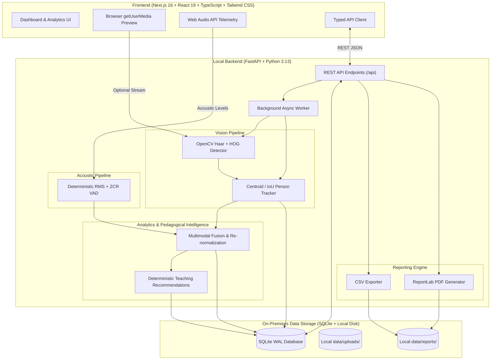
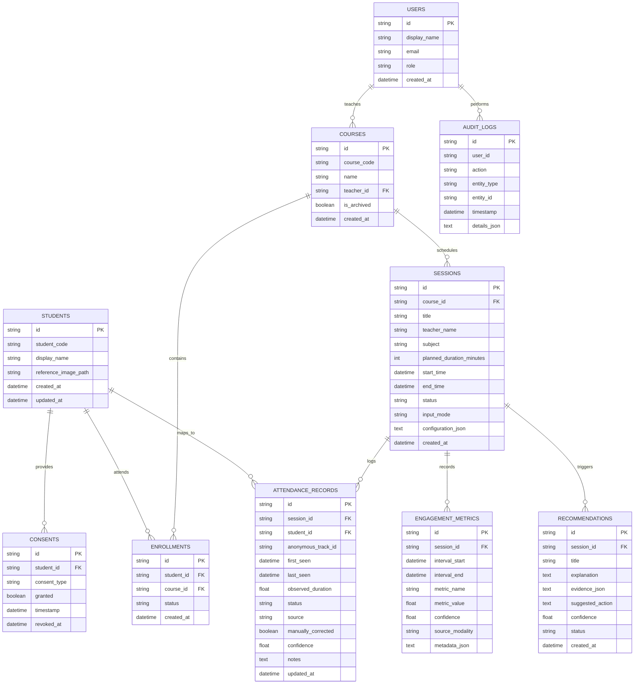

# Multimodal Attendance & Engagement Agent

A complete, privacy-preserving, offline-first artificial intelligence system designed for educational institutions, higher education classrooms, and professional training environments.

The system automates classroom presence verification and non-invasive multimodal engagement telemetry using local computer vision and acoustic indicators—**without sending audio, video, or biometric templates to any external cloud server or third-party API**.

---

## Architecture Diagram



---

## Database Entity-Relationship (ER) Diagram



---

## Key Features

1. **Automated Attendance Tracking**:
   - Supports 3 input modes: **Live Camera**, **Recorded Video Upload**, and **Simulated Classroom Session**.
   - Frame sampling at configurable rates (0.5 to 2.0 FPS).
   - Anonymous person tracking maintaining session track IDs (`TRK-001`, `TRK-002`, etc.).
   - Attendance status classification: `Present`, `Late`, `Left Early`, `Unverified`, `Manually Confirmed`, `Absent`.
   - Teacher attendance correction dialog with immutable compliance audit logging.

2. **Multimodal Engagement Telemetry**:
   - Visual telemetry: Participant presence over time, movement intensity via frame differencing, and head/facing orientation proxy.
   - Acoustic telemetry: Voice Activity Detection (VAD) using Root Mean Square (RMS) energy and Zero-Crossing Rate (ZCR).
   - Missing modality handling: Excludes inactive modalities and **renormalizes weights dynamically** to prevent skewed measurements.
   - Neutral pedagogical observations: E.g., *"Participation activity decreased during this interval."* rather than judgmental or speculative statements.

3. **Deterministic AI Teaching Assistant**:
   - 100% offline rule-based pedagogical recommendation engine (operates without OpenAI, Anthropic, or external API keys).
   - Detects prolonged lectures (>30 min), sudden interaction drops (>25%), quiet study windows, and sensor placement warnings.
   - Interactive recommendation workflow: `Accept`, `Complete`, or `Dismiss`.

4. **Institutional Privacy & FERPA Guarantees**:
   - Local on-premise SQLite database with Foreign Keys and Write-Ahead Logging (WAL) enabled.
   - Explicit student consent records for video presence and acoustic analysis.
   - Automated raw media deletion toggles and customizable data retention periods.
   - Irreversible privacy data purge mechanism requiring explicit confirmation.

5. **Reporting & Exports**:
   - RFC-4180 compliant CSV attendance register export.
   - Executive PDF session report generated on-device with ReportLab.
   - Machine-readable JSON telemetry export for institutional assessment and research.

---

## Quickstart & Installation

### Prerequisites
- Python 3.11+ (Tested on Python 3.13)
- Node.js 18+ and npm (Tested on Node v24)
- macOS, Linux, or Windows

### Step 1: Clone Repository and Setup Virtual Environment
```bash
git clone <repo-url>
cd "Multimodal project"

# Setup Python virtual environment
python3 -m venv venv
./venv/bin/pip install --upgrade pip
./venv/bin/pip install -r backend/requirements.txt
```

### Step 2: Initialize Database & Seed Demo Records
```bash
./venv/bin/python3 scripts/seed_demo.py
```
*Creates 15 fictional students, 2 academic courses (CS-301 and DATA-402), 4 historical sessions with realistic attendance records, and multimodal analytics.*

### Step 3: Install Frontend Dependencies
```bash
cd frontend
npm install
cd ..
```

---

## Running the Application

### Start Backend (Port 8000)
```bash
./venv/bin/uvicorn backend.app.main:app --host 127.0.0.1 --port 8000 --reload
```
- **API Documentation (Swagger UI)**: [http://127.0.0.1:8000/docs](http://127.0.0.1:8000/docs)
- **Health Endpoint**: [http://127.0.0.1:8000/api/health](http://127.0.0.1:8000/api/health)
- **Capabilities Endpoint**: [http://127.0.0.1:8000/api/health/capabilities](http://127.0.0.1:8000/api/health/capabilities)

### Start Frontend (Port 3000)
```bash
cd frontend
npm run dev
```
- **Dashboard Interface**: [http://localhost:3000](http://localhost:3000)

---

## Running Automated Tests

Run the complete backend test suite:
```bash
./venv/bin/pytest -v
```

All 13 test suites verify:
- Health and hardware capabilities detection
- Course and student CRUD operations with CSV import validation
- Session state lifecycle (`Draft` &rarr; `Ready` &rarr; `Running` &rarr; `Paused` &rarr; `Completed`)
- Manual attendance correction and audit trail entries
- Multimodal weight renormalization and telemetry calculations
- Deterministic pedagogical recommendation rules
- CSV and PDF report generation
- GDPR/FERPA privacy data purge verification

---

## Verification & URLs

| Component | URL | Description |
|-----------|-----|-------------|
| **Overview Dashboard** | [http://localhost:3000](http://localhost:3000) | Primary intelligence metrics and recent session records |
| **Live Session** | [http://localhost:3000/live](http://localhost:3000/live) | Camera preview, bounding box tracking, session timer |
| **Attendance Register** | [http://localhost:3000/attendance](http://localhost:3000/attendance) | Searchable register with manual correction modal |
| **Engagement Analytics** | [http://localhost:3000/analytics](http://localhost:3000/analytics) | Recharts trajectories, dynamic weight sliders, neutral insights |
| **AI Teaching Assistant**| [http://localhost:3000/assistant](http://localhost:3000/assistant) | Actionable pedagogical suggestions with evidence |
| **Students & Courses** | [http://localhost:3000/students](http://localhost:3000/students) | Roster management and CSV bulk import with error reporting |
| **Reports** | [http://localhost:3000/reports](http://localhost:3000/reports) | 1-click CSV and PDF downloads |
| **Privacy & Settings** | [http://localhost:3000/privacy](http://localhost:3000/privacy) | Retention policies, audit logs, and data purge |
| **FastAPI Swagger Docs**| [http://127.0.0.1:8000/docs](http://127.0.0.1:8000/docs) | Interactive OpenAPI 3.0 specification |

---

## Ethical & Privacy Principles

1. **Non-Invasive Behavioral Proxies**:
   Physical movement, head orientation, and voice activity are proxies for room dynamics, **never proof of comprehension, intellectual focus, or academic learning**.
2. **No Automated Grading or Discipline**:
   The system strictly prohibits automatic grading, student ranking, or punitive actions based on computer vision or acoustic signals.
3. **No Biometric Cloud Transmission**:
   Video frames and audio signals are decoded directly in local memory and discarded once telemetry counters are computed.
# Multimodal-project
